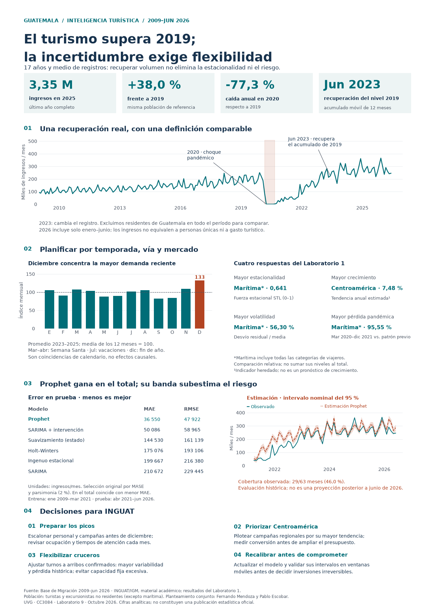

# El turismo supera 2019; la incertidumbre exige flexibilidad

**Laboratorio 9 · Visualización estática · CC3084 Data Science · UVG · 2026**

**Equipo:** Fernando Mendoza y Pablo Escobar.

## Entrega inmediata

El **avance del 15 de octubre** es el documento de explicación. La infografía vence el **18 de octubre**. Subir el repositorio no sustituye entregar en Canvas.

| Entregable | Archivo |
|---|---|
| **Memoria de diseño — PDF, 7 páginas** | [Descargar / visualizar](entregables/explicacion_diseno.pdf) |
| **Infografía PNG — 3507 × 4960 px, 300 ppp** | [Imagen en alta definición](entregables/infografia.png) |
| Infografía PDF — A3 vertical, una página | [A3, 297 × 420 mm](entregables/infografia_A3.pdf) |
| Infografía PDF — 11 × 17 pulgadas, una página | [11 × 17 pulgadas](entregables/infografia_11x17.pdf) |
| Código Python editable | [src/build.py](src/build.py) |
| Texto extraído de la fuente editable | [Memoria en texto](docs/explicacion_diseno.txt) |
| Cifras verificadas | [JSON](entregables/cifras_verificadas.json) |

El enunciado equipara A3 con 11×17 pulgadas, que son tamaños distintos. Se proporcionan ambas versiones sin deformar el diseño.



## Enlaces del espacio de trabajo e historial

- Repositorio: <https://github.com/lfmendoza/cc3084-lab9-visualizacion>
- Documento: <https://github.com/lfmendoza/cc3084-lab9-visualizacion/blob/main/entregables/explicacion_diseno.pdf>
- Infografía: <https://github.com/lfmendoza/cc3084-lab9-visualizacion/blob/main/entregables/infografia.png>
- Fuente editable de ambos: <https://github.com/lfmendoza/cc3084-lab9-visualizacion/blob/main/src/build.py>
- Historial: <https://github.com/lfmendoza/cc3084-lab9-visualizacion/commits/main/>

Este es el espacio versionado donde se trabajan texto y visualización: ambos se generan desde el código Python. El archivo de texto es un derivado para facilitar lectura; editar la función `explanation()` para cambiar el documento, e `infographic()` para cambiar la imagen.

## Reproducción profesional en WSL

Python **3.12.14**, uv **0.12.11**, dependencias resueltas en `uv.lock`. No requiere Excel, rutas de Windows ni la carpeta del laboratorio anterior.

```bash
git clone https://github.com/lfmendoza/cc3084-lab9-visualizacion.git
cd cc3084-lab9-visualizacion
mise trust
mise install
mise run setup
mise run build
mise run check
```

También puede ejecutarse con uv directamente:

```bash
uv sync --locked
uv run --locked python src/build.py
uv run --locked ruff check src tests
uv run --locked pytest -q
```

Las tareas leen `data/lab1/`, verifican sus huellas y generan todos los productos en `entregables/`. Los PDF contienen fuentes incrustadas y gráficos vectoriales. Su metadato temporal puede cambiar al regenerar; la reproducibilidad exigida es de cifras, contenido y formatos, no de bytes de PDF.

## Evidencia y límites

La fuente original se verificó con SHA-256. Se preservan las métricas del Laboratorio 1: **42 evaluaciones, siete series y 210 meses por serie**. El snapshot incluye cambios locales que no estaban en el último commit del repositorio base; [el manifiesto](docs/provenance.json) identifica exactamente los insumos utilizados.

- La población de referencia excluye residentes de Guatemala; la marítima es una excepción documentada y no se suma al total.
- 2025 es el último año completo. 2026 termina en junio.
- Prophet gana en la serie total, pero su banda nominal del 95 % cubre solo **29/63 meses (46,0 %)**. No se oculta esta limitación.
- El gráfico evalúa el conjunto de prueba; no se inventan pronósticos posteriores a junio de 2026.
- Se documentan la selección sobre el conjunto de prueba, el diagnóstico sobre toda la serie y la compresión temporal del indicador de crecimiento heredado.

La memoria explica paleta, jerarquía, elección de gráficos, recomendaciones, incertidumbre y correspondencia con la rúbrica. Los CSV permiten revisar todas las métricas, no solo las destacadas en la imagen.

## Calidad y colaboración

**19 pruebas automáticas** verifican integridad, calendario, KPIs, ganadores, errores, cobertura, contraste, dimensiones, páginas y CSV. GitHub Actions reconstruye y verifica los entregables.

Fernando Mendoza y Pablo Escobar plantearon conjuntamente los prompts de la sesión para orientar la implementación del documento y la infografía, según la aclaración de Fernando. Se reconoce esa contribución compartida mediante créditos y coautoría Git vinculada a sus cuentas. [Registro de contribuciones y alcance](docs/colaboracion.txt).

## Pendientes administrativos reales

- Entregar el PDF de avance en Canvas dentro del plazo; no se ha realizado desde este entorno.
- Confirmar inscripción del equipo en el grupo de Canvas.
- Proporcionar usuarios de GitHub del profesor y auxiliares para dar acceso al historial.

Los datos y la infografía son de uso académico. El enunciado pide consulta previa antes de publicación abierta. El repositorio se mantiene privado para contener los materiales completos; no se afirma que exista autorización docente para difundirlos. No se garantiza una calificación ni se acredita como realizado ninguno de los pasos pendientes.
